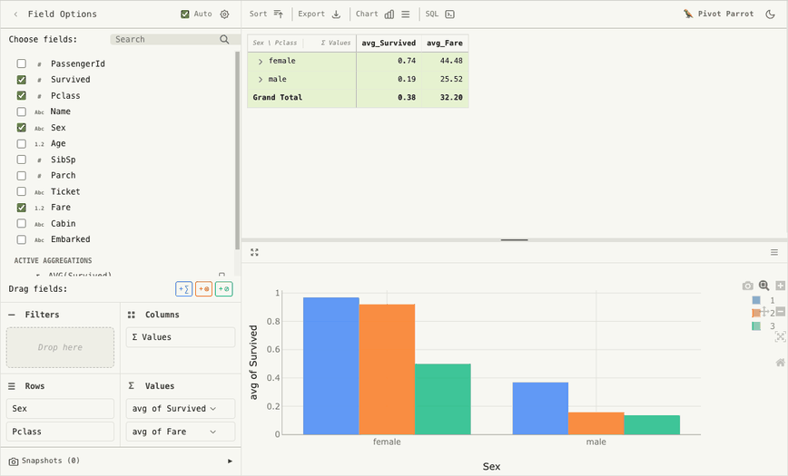
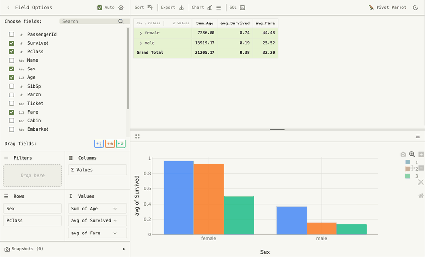
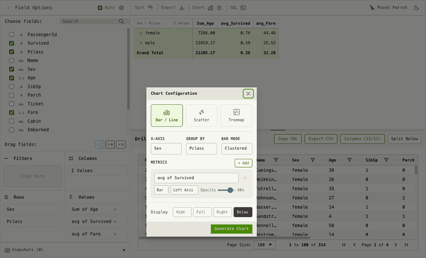

<h1 align="center">Pivot Parrot 🦜</h1>

<p align="center">
  <b>Excel-style pivot tables for Jupyter, Streamlit, and React — powered by DuckDB.</b><br/>
  Drag-and-drop analysis on 100k+ rows, right in the browser. No server required.
</p>

<p align="center">
  <a href="LICENSE"></a>
  
  
</p>

<p align="center">
  <a href="https://pjoachims.github.io/pivot-parrot/"><b>🦜 Try the live demo</b></a> — pivot a sample dataset or upload your own CSV, right in the browser.
</p>

---

<p align="center">
  
</p>

Hand it a DataFrame, get an interactive pivot table. Every aggregation is a real SQL query — run by DuckDB WASM inside the browser, or by your warehouse in remote mode. Rearranging fields is instant thanks to CUBE query caching.

## Jupyter

```bash
pip install jupyter-pivot-parrot
```

```python
import pandas as pd
from jupyter_pivot_parrot import PivotParrot

df = pd.read_csv("titanic.csv")

w = PivotParrot(
    data=df,
    rows=["Sex", "Pclass"],
    values=[{"field": "Survived", "aggregation": "avg"}],
)
w
```

Explore visually, then freeze the result as reproducible code — `w.config` is live-updated as you drag fields around:

```python
>>> w.config
{'rows': ['Sex', 'Pclass'], 'values': [{'field': 'Survived', 'aggregation': 'avg'}], ...}
```

Works in JupyterLab, classic Notebook, VS Code, and Colab (built on [anywidget](https://anywidget.dev)).

## Drill down to the raw rows

Every cell in the pivot is backed by SQL — right-click it to see exactly which rows produced the number.

<p align="center">
  
</p>

## Charts and dark mode

One click turns the current pivot into a Plotly chart. Both the table and the chart follow the built-in light/dark theme.

<p align="center">
  
</p>

## Remote mode: pivot your warehouse

Browser memory ends somewhere. Pass a `connection` instead of a DataFrame and the SQL runs on your side — Databricks, DuckDB, anything — while only aggregates travel to the widget:

```python
class MyConnection:
    def execute_query(self, sql, timeout=None):
        return warehouse.sql(sql).to_pandas()   # any DataFrame/Arrow-returning callable

w = PivotParrot(
    connection=MyConnection(),
    query="SELECT * FROM sales_2026",
)
```

The same protocol powers both wrappers; `streamlit-pivot-parrot` ships a ready-made `DatabricksConnection`.

## Streamlit

```bash
pip install streamlit-pivot-parrot
```

```python
import streamlit as st
from streamlit_pivot_parrot import pivot_table

config = pivot_table(data=df, rows=["region"], key="pivot")
```

## React

The core library is a standalone React component:

```jsx
import { Pivot } from 'pivot-parrot';
import * as duckdb from '@duckdb/duckdb-wasm';

<Pivot config={{ mode: 'local', duckdb, data: arrowBytes }} />
```

### Saved snapshots

A snapshot is a saved view: the pivot config, sort, chart, split and the open drilldown's filters, never the result data. Loading one re-runs its query, so the numbers are always current. By default snapshots live in memory for as long as the component does. Pass `snapshotStore` to keep them elsewhere, for example per user on your server. If a store call fails, the Snapshots panel shows the error and the pivot keeps working. Each view carries `v: 1`, so a stored view can be migrated when its shape changes.

```jsx
const snapshotStore = {
  list: () => fetch('/api/views').then(r => r.json()),
  save: (view) => fetch('/api/views', {
    method: 'POST',
    headers: { 'Content-Type': 'application/json' },
    body: JSON.stringify(view),           // { id?, name, view }
  }).then(r => r.json()),                 // -> { id, name, createdAt, view }
  remove: (id) => fetch(`/api/views/${id}`, { method: 'DELETE' }).then(() => {}),
};

<Pivot config={{ mode: 'local', duckdb, data: arrowBytes, snapshotStore }} />
```

To keep saved views in your own UI instead, hide the panel with `settings.showSnapshots: false` and use the ref. `getView()` returns the view a snapshot would hold now (plain JSON, `null` until the first query has run). `loadView(view)` restores one the way the panel does and throws on a version other than 1. Called before the pivot has finished loading, it waits until it has, and the last call wins, so loading `?view=<id>` right after mount works.

```tsx
import { Pivot, type PivotHandle, type PivotView } from 'pivot-parrot';

const pivot = useRef<PivotHandle>(null);

const save = () => api.saveView(pivot.current?.getView());
const open = (view: PivotView) => pivot.current?.loadView(view);

<Pivot ref={pivot} config={{ mode: 'local', duckdb, data: arrowBytes, settings: { showSnapshots: false } }} />
```

The [live demo](https://pjoachims.github.io/pivot-parrot/) is this component wrapped in a small shell ([`demo-app/`](demo-app)), deployed to GitHub Pages on every push to `main`.

## Features

- **Drag-and-drop pivoting** — rows, columns, values, filters; instant reordering via SQL CUBE caching
- **Real SQL underneath** — custom metrics, filters, and groupings as SQL expressions; a SQL playground for going off-road
- **Drilldown** — right-click any cell to inspect the underlying rows
- **Charts** — bar/line, scatter, treemap via Plotly (lazy-loaded, theme-aware)
- **Local or remote** — DuckDB WASM in the browser, or your own warehouse via a two-method connection protocol
- **Arrow end-to-end** — zero-copy columnar data transfer between Python and the browser
- **Snapshots & export** — save views (in memory or in your own store), export to CSV

## Packages

| Package | What it is |
|---|---|
| [`pivot-parrot`](packages/pivot-parrot) | Core React library: engine, UI components, theming |
| [`jupyter-pivot-parrot`](jupyter-pivot-parrot) | Jupyter widget (anywidget) — notebooks anywhere |
| [`streamlit-pivot-parrot`](streamlit-pivot-parrot) | Streamlit component with local + remote modes |

## Development

```bash
npm install && npm run build          # core library
cd jupyter-pivot-parrot/frontend
npm install && npm run build          # jupyter widget bundle
cd .. && uv pip install -e .          # jupyter package (editable)
uv run pytest tests/                  # widget tests
```

DuckDB WASM and Plotly load from jsDelivr at runtime, so the browser needs network access.

Deeper reading: [architecture](docs/ARCHITECTURE.md) · [store-vs-props conventions](docs/STORE_VS_PROPS.md)

## License

MIT
